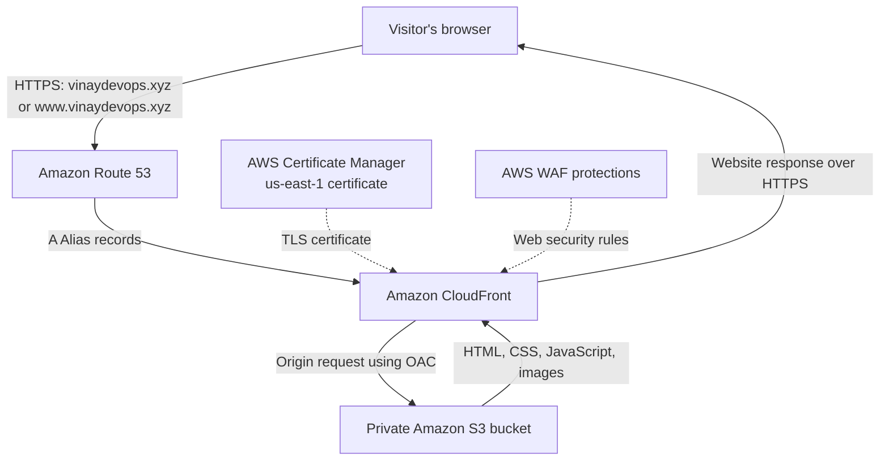

# Architecture and workflow

## Architecture diagram

## Request flow

1. A visitor opens `https://vinaydevops.xyz` or `https://www.vinaydevops.xyz`.
2. Route 53 resolves the domain using its A-alias record to the CloudFront distribution.
3. CloudFront presents the ACM certificate for the custom domain and establishes HTTPS.
4. CloudFront applies the configured WAF protections.
5. CloudFront retrieves the requested object from the private S3 bucket using Origin Access Control (OAC).
6. CloudFront returns the website content to the visitor.

## Components

- **S3 bucket:** stores the static website assets. The bucket is intended to remain private; CloudFront is the delivery layer.
- **CloudFront:** serves the website globally. The default root object is configured as `index.html`.
- **OAC:** signs requests from CloudFront to S3 so the bucket does not need public read access.
- **Route 53:** hosts the public DNS zone and routes both domain names to CloudFront.
- **ACM:** holds the public certificate for `vinaydevops.xyz` and `www.vinaydevops.xyz`. For CloudFront, the certificate must be in `us-east-1`.
- **WAF:** provides the security protections selected during CloudFront setup.

## Important distinction

GitHub stores the source code and documentation. It is not part of the live request path shown above. The AWS resources provide the live hosting.
